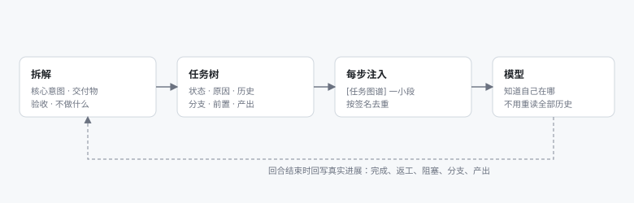
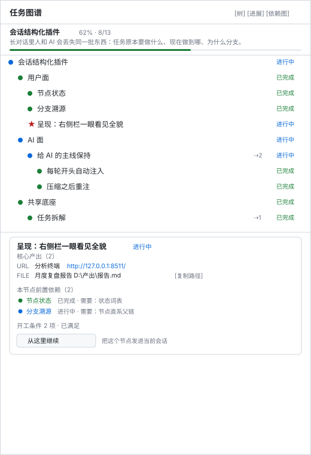
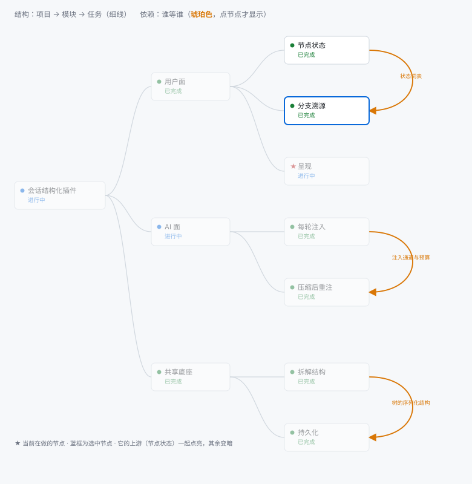

# dsh-task-atlas · 任务图谱 (Task Atlas)

[](https://github.com/ateen18/dsh-task-atlas/actions/workflows/ci.yml)

[中文](README.md) · English

A **project breakdown + task tree** for DeepSeek Harness, built for two readers at once: you and the model.

It targets one concrete failure of long conversations: **the longer the context, the fainter the main line**. Process noise — stack traces, file dumps, dead ends — buries "what were we doing, where are we, why is this here". You cannot find it by scrolling, and the model cannot reconstruct it from history.

So the plugin does two things: it keeps a tree in the right sidebar that follows real progress, and before each step it hands the model a short line saying where the work currently stands.

<p align="center">
  
</p>

> The figures are rendered by the plugin's own layout code from representative data — not screenshots. They cannot go stale when the panel changes, and they cannot show a state the code would never produce.

## What it does

### For you

<p align="center">
  
</p>

- **The breakdown is pinned at the top**: core intent, deliverables (each with its own acceptance), the decomposition, overall acceptance, explicit non-goals, constraints, priority order. Settled once at kickoff, visible and editable afterwards (every edit is recorded).
- **Three views**, each answering a different question over the same data:
  - **Tree** (default): dense, carries reasons, auto-expands the current path — for working and for spotting problems
  - **Progress**: per-module bars and a change timeline — for reading the shape of the run
  - **Dependency canvas**: a mind map of the structure plus coloured dependency lines — for seeing the whole and "who waits for whom". Structure uses thin neutral lines, dependencies use amber; selecting a node lights what it waits for and what waits for it; branches fold
- **More than done/not done**: `pending / active / done / rework / blocked / dropped`. Negative states **require a reason** and keep full history; out-of-order transitions **need your confirmation**.
- **Branch provenance**: work that arrives out of plan becomes a branch that remembers where it split from, why, what ends it, and where it rejoins. The node survives the merge.
- **Prerequisites**: `B.dependsOn = [A]` reads "A is required by B". Cycles are rejected. Each prerequisite can state **what** B needs from A, so an edge is a checkable claim rather than a guess about ordering.
- **Detail card**: breadcrumb, **openable outputs**, full note, **prerequisites coloured by their own status**, preconditions, reason, unblock condition, result, branch, history.
- **"Continue from here"**: sends a structured instruction (node, path, status, note, prerequisites, existing outputs) into the conversation so the next turn starts from that node.
- **Markdown mirror**: every turn end writes `<workspace>/.dsh/task-atlas.md` — readable, diffable, commit-friendly.

<p align="center">
  
</p>

### For the model (automatic; it does not have to remember)

A short state line is injected in `agent/pre-step`, **only when it is actually needed**:

| When | What |
|---|---|
| The state signature changed (focus moved, something finished, counts shifted) | Current node, path, prerequisites, next step (~35 tokens measured; hard budget 420 characters) |
| The context was just compacted | The same, plus "the atlas was not compacted; the progress below still holds" |
| 20 steps without touching the atlas | "Ignore this if you are still on the current node; otherwise record a branch or update the status" |
| Two consecutive off-topic user messages | **Ask before answering**: "Is this a temporary question, or a new project? I will continue once you tell me" |

A failed injection degrades to "no injection" — it never breaks a turn.

## Install

### Requirements

| Need | Notes |
|---|---|
| Node.js **≥ 22.19** (or 24+) | The repository's `engines` |
| pnpm | Every command below uses it |
| DSH Desktop or `dsh web` | Tested on `0.2.1-rc.2` |

### Option 1: let your agent install it (one prompt)

Paste this into your DSH agent (the prompt is written in Chinese; it works as-is, or translate the intent):

```text
帮我安装 DSH 插件「任务图谱」（dsh-task-atlas），仓库是 https://github.com/ateen18/dsh-task-atlas
按这个顺序做，每步做完告诉我结果：

1. 克隆到 ~/dsh-plugins/dsh-task-atlas（目录不存在就先建）。如果 HTTPS 连不上 GitHub，改用 git@github.com:ateen18/dsh-task-atlas.git。
2. 在克隆目录里执行 pnpm install，然后 pnpm run build。
   这一步不能省：仓库里没有 lib/（构建产物不进版本库），而 package.json 的 main 指向 lib/index.js，跳过它插件会加载失败。
3. 进入 ~/.dsh/profiles/desktop，执行 pnpm add link:<克隆目录的绝对路径>。
   如果你用的是 web profile，把 desktop 换成 web。
4. 编辑同目录的 package.json，把 "dsh-task-atlas" 加进 dsh.profile.bundles 数组；已经在里面就不要重复加。
   漏了这一步，宿主按包名找不到插件，重启后面板不出现也不报错。
5. 可选：把 <克隆目录>/skills/task-atlas 整个目录复制到 ~/.dsh/skills/，这是配套的 skill。

装完请报告三件事：lib/index.js 是否存在、profile 的 bundles 里是否已包含 dsh-task-atlas、以及我接下来该怎么重启应用。
不要用 pnpm add dsh-task-atlas —— 这个包没有发布到 npm，会 404。也不要改动存储域名 dsh_task_atlas 或工作区里的 .dsh/task-atlas.* 文件，那些是已有数据。
```

Afterwards you only need to **quit the app fully and start it again** (closing the window only hides it to the tray).

### Option 2: install it yourself (five steps)

**1. Clone and build**

```sh
git clone https://github.com/ateen18/dsh-task-atlas.git
cd dsh-task-atlas
pnpm install
pnpm run build
```

> **The build is required.** The repository has no `lib/` (build output is not committed) while `package.json`'s `main` points at `lib/index.js`. Skip this and the plugin fails to load.

**2. Install into the profile**

```sh
cd ~/.dsh/profiles/desktop
pnpm add link:<absolute path to the clone>
```

**3. Make the profile load it**

Edit `~/.dsh/profiles/desktop/package.json` and add the package name to `dsh.profile.bundles`:

```json
{
  "dsh": { "profile": { "bundles": [
    "@deepseek-ai/dsh-base",
    "@deepseek-ai/dsh-web-app",
    "dsh-task-atlas"
  ] } }
}
```

> With step 2 but not step 3, the host cannot find the plugin by package name: **the panel simply never appears, with no error**. This is the one step that is easy to miss.

**4. Quit the app and start it again**

Quit completely — closing the window only hides it to the tray.

**5. Verify**

"▤ 任务图谱" appears at the bottom of the left sidebar, or a card appears on the right sidebar's guide page.

### Why not `pnpm add github:ateen18/dsh-task-atlas`

Tried; **unreliable on pnpm 11**:

```
ERR_PNPM_GIT_DEP_PREPARE_NOT_ALLOWED
The git-hosted package "dsh-task-atlas@0.0.1" needs to execute build scripts
but is not in the "allowBuilds" allowlist.
```

pnpm 11 refuses to run a git dependency's build scripts by default (and the build *is* needed, since `lib/` is not committed). Doing it this way means allowlisting the package in your own `pnpm-workspace.yaml` and having GitHub reachable. The repository does ship a `prepare` script, so installing from git with `npm install` builds automatically; pnpm users should use the five steps above.

### Upgrade

```sh
cd <clone>
git pull
pnpm install && pnpm run build
```

Then restart the app. **Source changes always require a rebuild** — what is installed is `lib/`, not `src/`.

### Uninstall

```sh
cd ~/.dsh/profiles/desktop
pnpm remove dsh-task-atlas
```

Remove `dsh-task-atlas` from `dsh.profile.bundles` as well, then restart.

### Companion skill (recommended)

The tools document their own usage, but the **judgement** lives in the skill: when to break work down, how to write `result`, why the model must not mark a node as *rework* on its own, that outputs should be registered as openable handles, and **how to treat the message starting with `[任务图谱]`** (it is plugin-generated context, not something you said).

```sh
mkdir -p ~/.dsh/skills
cp -r <clone>/skills/task-atlas ~/.dsh/skills/
```

Windows PowerShell equivalent (`cp -r` works in PowerShell, but relies on parameter abbreviation):

```powershell
Copy-Item -Recurse <clone>\skills\task-atlas $HOME\.dsh\skills\
```

## Tools (19)

| Tool | Permission | What it does |
|---|---|---|
| `atlas_status` | read | The only read entry point: breakdown + progress + tree + prerequisites + focus + pending confirmations |
| `atlas_breakdown_draft` | — | Validate a draft breakdown without writing it |
| `atlas_breakdown_confirm` | — | Create the project, store the breakdown, create its modules |
| `atlas_breakdown_amend` | AI | Amend the breakdown — **a reason is mandatory**, recorded field by field |
| `atlas_node_add` / `atlas_node_update` | AI | Add or edit nodes (the parent fixes the level; `needs` preconditions and `dependsOn` are replaced wholesale) |
| `atlas_node_move` | AI | Move a node with its subtree; level is re-derived, status and history survive |
| `atlas_focus` | AI | Declare "this is what I am working on" |
| `atlas_node_done` | AI | Finish a node; `result` is required |
| `atlas_node_status` | **tiered** | `active` / `pending` autonomous; `rework` / `blocked` / `dropped` need your confirmation; so does restoring a dropped node |
| `atlas_confirm` | you | Apply one queued confirmation |
| `atlas_branch_create` / `atlas_branch_resolve` | AI | Register a branch and merge it back |
| `atlas_output_add` / `atlas_output_remove` | AI | Register a node's **openable handles** (URL / file / directory); re-registering the same target replaces it |
| `atlas_node_delete` | safety valve | Deletes only nodes that never carried a decision |
| `atlas_workspace_history` | read | Decide, before kickoff, whether this workspace has prior work |
| `atlas_tidy_titles` | AI | Tighten sentence-shaped titles into short labels, moving the explanation into the note; reports by default, writes only with `apply: true` |
| `atlas_restore` | you | Restore the whole document from `<workspace>/.dsh/task-atlas.json`; a non-empty document needs an explicit `overwrite` |

## Configuration

Override per row in the profile's `cordis.patch.yml` (`config` is replaced wholesale, not deep-merged):

```yaml
- id: task-atlas
  config:
    enabled: true          # master switch
    exportMarkdown: true   # write the Markdown mirror
    exportDir: .dsh        # mirror directory, relative to the workspace
    inject: true           # inject state into the model; turn off if it feels noisy — the panel is unaffected
```

## Deliberate design choices

- **`done` is not terminal.** `done → rework` is legal. The whole point is to give "finished, but it needs changing" a legitimate expression.
- **Dropped is nearly terminal.** The only exit is `dropped → active`, which requires a reason and your confirmation — the reason goes to history, not to the node's live field.
- **Negative states need your confirmation.** A tree that turns red must be trustworthy; a tree that turns red by itself is a tree nobody reads twice.
- **Progress counts leaves only**, and dropped nodes leave both numerator and denominator — otherwise one plan change freezes the percentage forever and you stop believing the number.
- **The dependency view was deleted once and rebuilt in a different shape.** The first version was a dagre layered graph; it was unreadable on a real workspace and went away (client bundle 158 kB → 70 kB). The current one is a **mind map**: the structure is the tree, dependencies are **coloured lines on top**, hidden by default and shown for the selected node. Conclusion: dependencies belong as an annotation over structure, not as a replacement for it.
- **Dependency lines and hierarchy lines are different things and must look different.** Hierarchy is thin, neutral, always present. Dependency is thick, amber, arrowed, and appears on click. Two nodes on the same level connect right-edge to right-edge (right-to-left looped back across both cards); an ancestor and its descendant reuse the existing hierarchy link and only recolour it, instead of drawing a second line across the tree.
- **The panel refreshes by long polling, not a timer.** Writes broadcast a revision; a parked request answers immediately — roughly 6 idle requests per minute (was 24), and changes arrive instantly.
- **Server-sent events were built and unit-tested, and were not adopted**: the host's web server ends streamed responses, so every "push" became "connect, then drop".
- **The client bundle may only `require` platform modules** (react and friends). Third-party libraries must be inlined; a build guard fails the build when someone breaks that rule.
- **Injection only travels as a user message**: `agent/pre-step` accepts user messages, and `agent/pre-call` explicitly cannot mutate them. So injected text does appear in the transcript; the `[任务图谱]` prefix exists to say "you did not write this".

## Data

- **Source of truth**: the `documents` table of the `dsh_task_atlas` domain in `ctx.storageDomain` — one record per workspace, validated by zod.
- **Mirror**: `<workspace>/.dsh/task-atlas.md`, rewritten at every turn end, write-only.
- **Data surface**: `GET /task-atlas/state` (snapshot with `revision` and `drift`), `GET /task-atlas/wait?revision=N` (long poll), `POST /task-atlas/confirm`.
- **Legacy keys**: records that stored `charter` are normalised to `breakdown` on read — the rename never migrated stored data, so the reader has to accept the old key or the whole domain fails to open.

## Development

```sh
pnpm install
pnpm run typecheck    # tsc --noEmit
pnpm test             # node --test test/*.test.ts (289 tests)
pnpm run build        # tsdown + the client dependency guard
```

Two diagnostic scripts (measurement, not guesswork):

```sh
node scripts/check-storage.mjs             # does the stored record still satisfy the schema?
node scripts/check-running-build.mjs PORT  # is the running process on the current build, and do the routes answer?
```

`scripts/restart-desktop.ps1` **no longer kills anything**. The header explains why: closing the window only hides it to the tray, force-killing the host makes the desktop app show a "host exited" error, and the script itself is a child of that host.

README figures are generated, not captured:

```sh
node scripts/render-readme-images.mjs   # rewrites docs/images/*.svg
```

## Compatibility

Targets DSH `0.2.1-rc.2` (`@deepseek-ai/*@0.2.1-rc.2`, cordis `~4.0.5`, zod pinned at `4.4.3`). DSH updates nightly and its plugin surface moves, so:

- Only `tools` is a hard dependency; storage, the web server and the conversation corpus are late-bound. A missing service is reported in the panel instead of making the whole plugin vanish.
- If storage is unavailable the plugin still starts, shows the reason, and writes `~/.dsh/task-atlas-startup.log`.

## Known unverified

Listed so that "should work" is not mistaken for "works":

- **Re-injection after compaction**: the signal is `compaction/end`, a name taken from the runtime event table; a real compaction has not been observed in this build.
- **Topic drift**: well covered by unit tests, but the false-positive rate in real conversations is unknown. Known weak point: synonyms ("sidebar" instead of "panel") read as off-topic.
- **Visual review**: the panel's look has only been checked from the developer's side, without real user feedback.

## License

MIT — full text in [LICENSE](LICENSE), reproduced here:

<details>
<summary>MIT License</summary>

```text
MIT License

Copyright (c) 2026 dsh-task-atlas contributors

Permission is hereby granted, free of charge, to any person obtaining a copy
of this software and associated documentation files (the "Software"), to deal
in the Software without restriction, including without limitation the rights
to use, copy, modify, merge, publish, distribute, sublicense, and/or sell
copies of the Software, and to permit persons to whom the Software is
furnished to do so, subject to the following conditions:

The above copyright notice and this permission notice shall be included in all
copies or substantial portions of the Software.

THE SOFTWARE IS PROVIDED "AS IS", WITHOUT WARRANTY OF ANY KIND, EXPRESS OR
IMPLIED, INCLUDING BUT NOT LIMITED TO THE WARRANTIES OF MERCHANTABILITY,
FITNESS FOR A PARTICULAR PURPOSE AND NONINFRINGEMENT. IN NO EVENT SHALL THE
AUTHORS OR COPYRIGHT HOLDERS BE LIABLE FOR ANY CLAIM, DAMAGES OR OTHER
LIABILITY, WHETHER IN AN ACTION OF CONTRACT, TORT OR OTHERWISE, ARISING FROM,
OUT OF OR IN CONNECTION WITH THE SOFTWARE OR THE USE OR OTHER DEALINGS IN THE
SOFTWARE.
```

</details>
